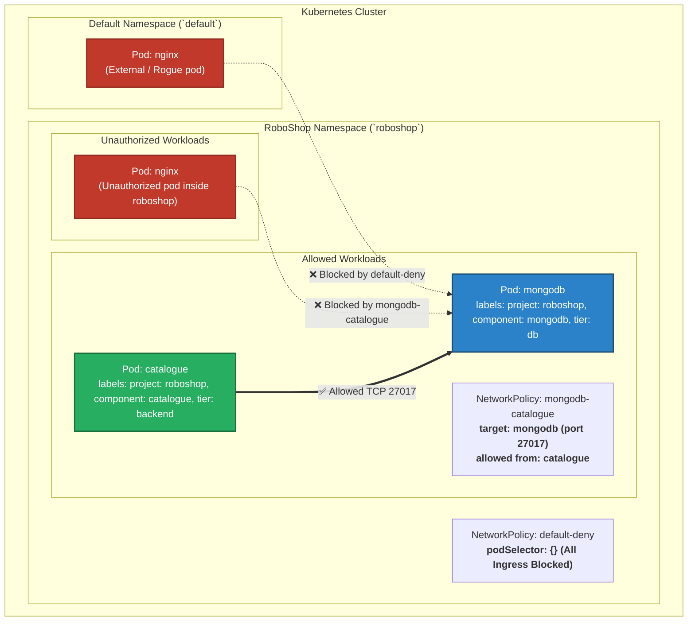

# Kubernetes Network Policies & Zero-Trust Traffic Isolation (`k8-network`)

This repository demonstrates how to implement **Zero-Trust Network Security** in Kubernetes using native `NetworkPolicy` resources. It covers baseline **Default-Deny Ingress**, fine-grained **Pod-to-Pod Whitelisting**, cross-namespace traffic evaluation, and debugging.

---

## 🏗️ Architecture & Traffic Isolation Model



---

## 📁 Repository Manifest Matrix

| Manifest File | Kind | Namespace | Target / Purpose |
| :--- | :--- | :--- | :--- |
| [`deny-default.yaml`](file:///Users/sriramcharankolla/Desktop/DevOps/k8-network/deny-default.yaml) | `NetworkPolicy` | `roboshop` | **Default-Deny All Ingress**: Blocks all unsolicited ingress traffic across the entire `roboshop` namespace (`podSelector: {}`) |
| [`mongodb-catalogue.yaml`](file:///Users/sriramcharankolla/Desktop/DevOps/k8-network/mongodb-catalogue.yaml) | `NetworkPolicy` | `roboshop` | **Whitelist Rule**: Permits only pods matching `project: roboshop`, `component: catalogue`, `tier: backend` to connect to `mongodb` on TCP port `27017` |
| [`roboshop.yaml`](file:///Users/sriramcharankolla/Desktop/DevOps/k8-network/roboshop.yaml) | `Pod` | `roboshop` | Test NGINX pod running inside `roboshop` namespace to verify intra-namespace denial |
| [`default.yaml`](file:///Users/sriramcharankolla/Desktop/DevOps/k8-network/default.yaml) | `Pod` | `default` | Test NGINX pod running in `default` namespace to verify cross-namespace denial |

---

## 🔑 Core Concepts & Policy Mechanics

### 1. Default-Deny Security Baseline
* By default in Kubernetes, pod networking is **flat and fully open** (any pod in any namespace can communicate with any other pod).
* Applying [`deny-default.yaml`](file:///Users/sriramcharankolla/Desktop/DevOps/k8-network/deny-default.yaml) isolates all pods in `roboshop`:
  ```yaml
  spec:
    podSelector: {}      # Matches every pod in namespace
    policyTypes:
      - Ingress          # Drops all incoming traffic without an explicit allow rule
  ```

### 2. Whitelist Isolation ([`mongodb-catalogue.yaml`](file:///Users/sriramcharankolla/Desktop/DevOps/k8-network/mongodb-catalogue.yaml))
* Explicitly permits ingress only from pods matching all 3 labels (`project=roboshop`, `component=catalogue`, `tier=backend`) strictly to port `27017`.
* All other traffic (HTTP, SSH, ICMP, arbitrary pod ports) remains strictly rejected.

### 3. CNI Requirement Note
> [!IMPORTANT]
> Kubernetes `NetworkPolicy` requires a CNI plugin that enforces policy rules (such as **AWS VPC CNI Network Policy Controller**, **Calico**, or **Cilium**).
> For AWS EKS VPC CNI, ensure Network Policy support is enabled via:
> ```bash
> kubectl set env daemonset aws-node -n kube-system ENABLE_NETWORK_POLICY_CONTROLLER=true
> ```

---

## 🚀 Step-by-Step Testing & Verification Workflow

### Step 1: Deploy Workloads & Test Pods
```bash
# 1. Create roboshop namespace:
kubectl create namespace roboshop

# 2. Deploy test pods:
kubectl apply -f default.yaml               # Pod in default namespace
kubectl apply -f roboshop.yaml              # Pod in roboshop namespace

# 3. Deploy target MongoDB service/pod (if not already running):
kubectl run mongodb --image=mongo:4.4 -n roboshop --labels="project=roboshop,component=mongodb,tier=db"
kubectl run catalogue --image=busybox -n roboshop --labels="project=roboshop,component=catalogue,tier=backend" -- sleep 3600
```

---

### Step 2: Apply Default-Deny Network Policy
```bash
# Apply baseline ingress block:
kubectl apply -f deny-default.yaml

# Verify NetworkPolicy is active:
kubectl get networkpolicy -n roboshop
```

**Test denial from unauthorized pods:**
```bash
# 1. Test from unauthorized pod in roboshop:
kubectl exec -n roboshop nginx -- nc -zv -w 3 <MONGODB_IP> 27017
# Result: Connection timed out / Refused ❌

# 2. Test from pod in default namespace:
kubectl exec -n default nginx -- nc -zv -w 3 <MONGODB_IP> 27017
# Result: Connection timed out / Refused ❌
```

---

### Step 3: Apply Granular Allow Rule for Catalogue
```bash
# Apply whitelist policy allowing catalogue -> mongodb:
kubectl apply -f mongodb-catalogue.yaml

# Test from authorized catalogue pod:
kubectl exec -n roboshop catalogue -- nc -zv -w 3 <MONGODB_IP> 27017
# Result: open (Connection successful!) ✅

# Verify unauthorized nginx in roboshop is STILL blocked:
kubectl exec -n roboshop nginx -- nc -zv -w 3 <MONGODB_IP> 27017
# Result: Connection timed out ❌
```

---

## 🛠️ Troubleshooting & Debugging Guide

### 1. Traffic Allowed Despite `default-deny` Policy
* **Cause 1:** CNI does not support Network Policies or Network Policy Controller is disabled.
  * **Fix:** Check EKS VPC CNI controller daemonset:
    ```bash
    kubectl get ds aws-node -n kube-system -o yaml | grep -i ENABLE_NETWORK_POLICY_CONTROLLER
    ```
* **Cause 2:** Pod labels do not match policy selector (policy not selecting the pod).
  * **Fix:** Inspect exact pod labels:
    ```bash
    kubectl get pods -n roboshop --show-labels
    ```

### 2. Traffic Blocked for Authorized Pods
* **Cause:** Missing label or port mismatch in `podSelector` / `ports`.
* **Fix:** Validate NetworkPolicy configuration:
  ```bash
  kubectl describe networkpolicy mongodb-catalogue -n roboshop
  ```

---

## 🧹 Safe Resource Cleanup & Teardown

```bash
# 1. Delete Network Policies:
kubectl delete -f deny-default.yaml
kubectl delete -f mongodb-catalogue.yaml

# 2. Delete test pods:
kubectl delete -f default.yaml
kubectl delete -f roboshop.yaml

# 3. Verify namespace status:
kubectl get networkpolicies,pods -n roboshop
```
